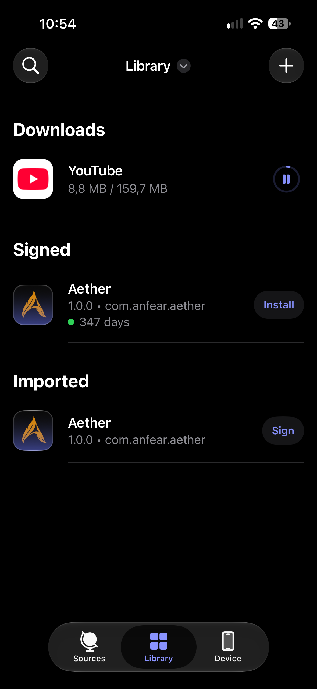
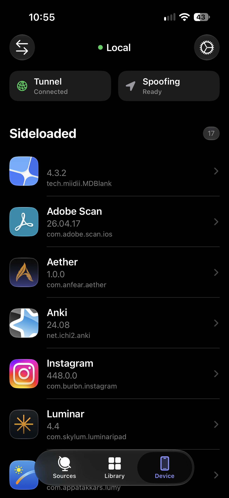
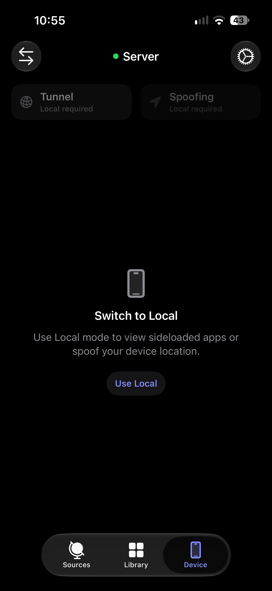
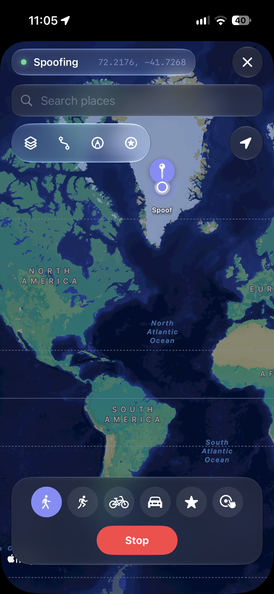
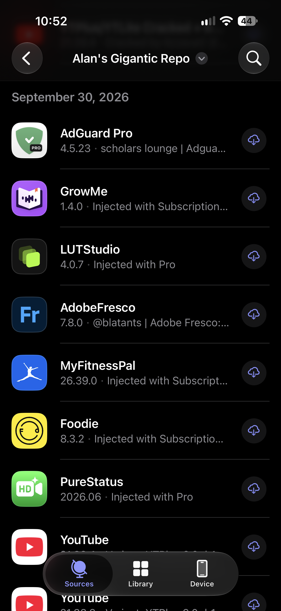
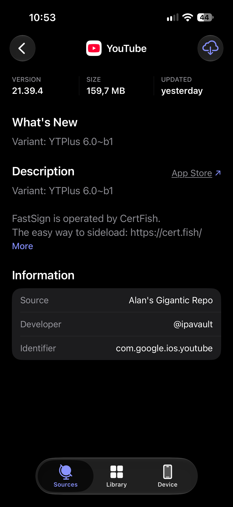
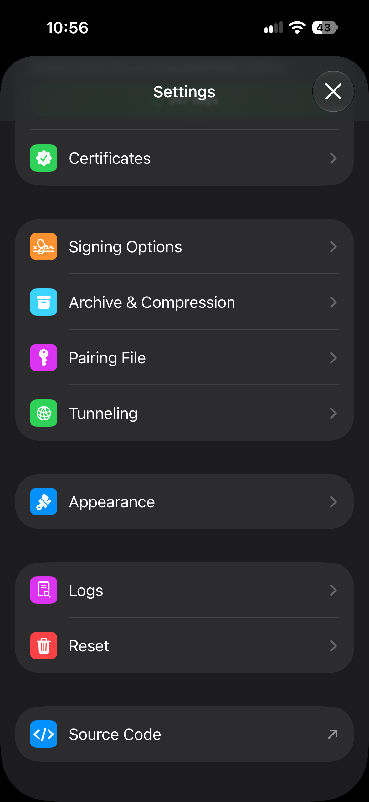

  

Aether started as a fork of [Feather](https://github.com/claration/feather) by Samara. I liked its clean look and simplicity, but it was missing a few things I needed. I built Aether around my own workflow and tried to make the additions feel seamless.

- A download queue with background progress, pause, resume, and retry, plus progress for exports.
- A Device tab for viewing sideloaded apps, inspecting their details and entitlements, and uninstalling them.
- Two install modes you can switch between from the Device header: **Server** hosts the IPA locally and installs through `itms-services`; **Local** installs directly through a tunnel and pairing file.
- On-device pairing on **iOS 27**, with pairing-file import still available.
- Built-in tunnelling, with LocalDevVPN as another option. Local mode starts the tunnel when Aether opens; Tunnel Lifecycle can turn it off in the background when nothing needs it.
- Optional Cellular Assist uses an Apple Shortcut to briefly turn Mobile Data off when it interferes with the in-app tunnel, then restores it.
- Location spoofing adapted from [Locus by ChrisMack32](https://github.com/ChrisMack32/Locus), with dynamic Remote Pairing port lookup instead of the original fixed port.
- A reworked UI—navigation, app lists, details, and controls—shaped around how I prefer to use the app.

**Requires iOS 26+.** I’m lazy and didn’t want to test two versions of the UI. Aether uses iOS 26’s Liquid Glass styling, so I made that the baseline and dropped the older compatibility path. Native iPad support was dropped too; I’m focusing on iPhone for now.

## Screenshots

  
  
  
  

  
More screenshots

  

    
    
    
  

## Download

Get the latest IPA from the [releases page](https://github.com/a-artho/Aether/releases).

## Acknowledgements

- [Feather](https://github.com/claration/feather) by Samara — the project Aether was originally forked from.
- [idevice](https://github.com/jkcoxson/idevice) — device communication.
- [Vapor](https://github.com/vapor/vapor) — local HTTP server support.
- [Zsign](https://github.com/zhlynn/zsign) — on-device code signing support.
- [Nuke](https://github.com/kean/Nuke) — image loading and caching.

## License

Aether is licensed under the [GNU GPL v3.0](LICENSE). It builds on GPL-licensed Feather code, so the fork remains under the GPL rather than adding an MIT license for the whole app.
